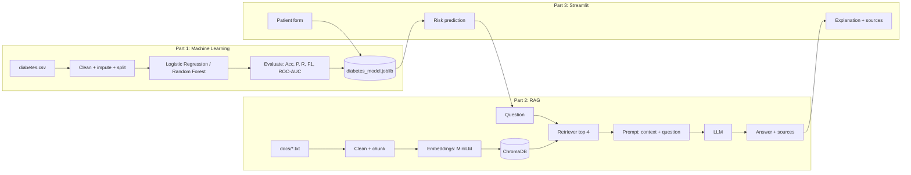

# 🩺 Healthcare AI Prototype: Diabetes Risk Prediction + RAG Q&A


A small healthcare AI prototype built for the **DKAI Tech AI/ML Engineer Assessment**. It combines two systems:

1. **Machine Learning**: predicts whether a patient is likely to have diabetes from clinical measurements.
2. **Retrieval-Augmented Generation (RAG)**: answers healthcare questions *only* from a set of healthcare documents, shows the sources it used, and says so when the answer is not in the documents.
3. **Simple interface (optional)**: a Streamlit app where a user enters patient information, gets an ML risk prediction and receives a RAG-based explanation with document sources.

> ⚠️ **Disclaimer:** This is a demonstration prototype. It is **not** a medical device, has not been clinically validated, and must not be used for diagnosis or treatment decisions.

---

## 📑 Table of Contents
- [Features](#-features)
- [Architecture](#-architecture)
- [Project Structure](#-project-structure)
- [Tech Stack](#-tech-stack)
- [Setup](#-setup)
- [How to Run](#-how-to-run)
- [Part 1: Machine Learning](#-part-1-machine-learning)
- [Part 2: RAG System](#-part-2-rag-system)
- [Part 3: Streamlit Interface](#-part-3-streamlit-interface)
- [External APIs, Libraries and Pretrained Models](#-external-apis-libraries-and-pretrained-models)
- [Limitations](#-limitations)
- [Future Improvements](#-future-improvements)
- [Assignment Checklist](#-assignment-checklist)

---

## ✨ Features

| Area | What it does |
|---|---|
| Data cleaning | Removes duplicates; treats impossible zeros (e.g. glucose = 0) as missing values |
| Missing values | Median imputation inside a scikit-learn `Pipeline` (no data leakage) |
| Models | Logistic Regression and Random Forest |
| Metrics | Accuracy, Precision, Recall, F1-score, ROC-AUC |
| Prediction | `predict_risk()` returns probability, risk level (Low / Moderate / High) and class |
| RAG | Load → clean → chunk → embed → store in ChromaDB → retrieve → generate |
| Orchestration | LangChain **LCEL** chain (`prompt \| llm \| parser`) |
| Transparency | Shows source documents for each answer |
| Safety | Replies *"I could not find this information in the provided documents."* when the context has no answer |
| UI | Streamlit app combining ML prediction and RAG explanation |

---

## 🏗 Architecture



**The core LCEL idea in one line:**

```
question → retriever (Chroma) → prompt (context + question) → LLM → answer
```

---

## 📁 Project Structure

```
Healthcare-AI_DkaiTech-Assessment-/
├── data/
│   └── diabetes.csv                 # Pima Indians Diabetes dataset (768 rows)
├── docs/                            # 8 healthcare documents for RAG
│   ├── 01_diabetes_overview.txt
│   ├── 02_diabetes_symptoms.txt
│   ├── 03_diabetes_diagnosis.txt
│   ├── 04_diabetes_risk_factors.txt
│   ├── 05_diabetes_lifestyle.txt
│   ├── 06_diabetes_complications_emergencies.txt
│   ├── 07_hypertension_risk_factors.txt
│   └── 08_hypertension_lifestyle_and_when_to_see_doctor.txt
├── models/
│   ├── diabetes_model.joblib        # saved best model (created by train_model.py)
│   └── metrics.json                 # saved evaluation metrics
├── src/
│   ├── train_model.py               # Part 1: clean, split, train, evaluate, save
│   ├── predict.py                   # Part 1: prediction function
│   ├── build_index.py               # Part 2: load → chunk → embed → ChromaDB
│   └── rag_chain.py                 # Part 2: LCEL chain, sources, "not found" handling
├── app.py                           # Part 3: Streamlit app
├── requirements.txt
└── README.md
```

> `chroma_db/` (the vector store) is generated when you run `build_index.py`.

---

## 🧰 Tech Stack

- **Language:** Python 3.10+
- **ML:** scikit-learn, pandas, numpy, joblib
- **RAG:** LangChain (`langchain-core`, `langchain-chroma`, `langchain-huggingface`, `langchain-text-splitters`), ChromaDB
- **Embeddings:** `sentence-transformers/all-MiniLM-L6-v2` (free, runs locally)
- **LLM:** OpenAI `gpt-4o-mini` by default (Anthropic or local Ollama also supported)
- **UI:** Streamlit

---

## ⚙️ Setup

### 1. Clone the repository
```bash
git clone https://github.com/dineshsimakurthi/Healthcare-AI_DkaiTech-Assessment-.git
cd Healthcare-AI_DkaiTech-Assessment-
```

### 2. Create a virtual environment (optional but recommended)
```bash
python -m venv venv
source venv/bin/activate        # Windows: venv\Scripts\activate
```

### 3. Install dependencies
```bash
pip install -r requirements.txt
```

### 4. Configure the LLM (needed only for RAG answers)
The ML part needs **no API key**. The RAG answer step needs an LLM:

```bash
# Default: OpenAI
export OPENAI_API_KEY="sk-..."              # Windows (PowerShell): $env:OPENAI_API_KEY="sk-..."

# Option: Anthropic
pip install langchain-anthropic
export LLM_PROVIDER=anthropic
export ANTHROPIC_API_KEY="..."

# Option: Ollama (free, local)
pip install langchain-ollama
export LLM_PROVIDER=ollama                  # requires Ollama running with llama3.2 pulled
```

### Using Google Colab
Upload the project folder (or clone the repo), then run in cells:
```python
!pip install -r requirements.txt
import os; os.environ["OPENAI_API_KEY"] = "sk-..."
!python src/train_model.py
!python src/build_index.py
```
A GPU is **not** required.

---

## ▶️ How to Run

```bash
# Part 1: train and evaluate the ML models, save the best one
python src/train_model.py

# Part 1: try the prediction function
python src/predict.py

# Part 2: build the ChromaDB vector store (run once, or after changing docs/)
python src/build_index.py

# Part 2: ask questions in the terminal
cd src && python rag_chain.py

# Part 3: launch the web interface
streamlit run app.py
```

---

## 🤖 Part 1: Machine Learning

### Dataset
**Pima Indians Diabetes Dataset**: public, 768 patients, 8 numeric features, binary target.

Download link: <https://raw.githubusercontent.com/plotly/datasets/master/diabetes.csv>

| Feature | Description |
|---|---|
| `Pregnancies` | Number of pregnancies |
| `Glucose` | Plasma glucose concentration (mg/dL) |
| `BloodPressure` | Diastolic blood pressure (mmHg) |
| `SkinThickness` | Triceps skin-fold thickness (mm) |
| `Insulin` | 2-hour serum insulin (mu U/ml) |
| `BMI` | Body mass index |
| `DiabetesPedigreeFunction` | Family-history score for diabetes |
| `Age` | Age in years |
| `Outcome` | **Target**: 1 = diabetic, 0 = not diabetic (≈35% / 65%) |

### Step-by-step pipeline (`src/train_model.py`)

1. **Load and clean.** Duplicate rows are dropped. In `Glucose`, `BloodPressure`, `SkinThickness`, `Insulin` and `BMI`, a value of `0` is physically impossible, so it is converted to `NaN` (missing).
2. **Handle missing values.** Median imputation via `SimpleImputer`. Missing counts found: Glucose 5, BloodPressure 35, SkinThickness 227, Insulin 374, BMI 11.
3. **Train/test split.** 80% / 20%, **stratified** so both sets keep the same class ratio (614 train / 154 test, `random_state=42`).
4. **Train two classifiers**, each as a `Pipeline` so imputation and scaling are learned from the training data only:
   - Logistic Regression: `Imputer → StandardScaler → LogisticRegression`
   - Random Forest: `Imputer → RandomForest (200 trees, max_depth=5)`
5. **Evaluate** on the held-out test set.
6. **Select the best model** by ROC-AUC.
7. **Save** the model to `models/diabetes_model.joblib` and metrics to `models/metrics.json`.

### Results (test set, 154 patients)

| Model | Accuracy | Precision | Recall | F1-score | ROC-AUC |
|---|---|---|---|---|---|
| **Logistic Regression** | 0.708 | 0.600 | 0.500 | 0.545 | **0.813** |
| Random Forest | 0.740 | 0.659 | 0.537 | 0.592 | 0.807 |

### Which model is best, and why?
The two models are very close. Random Forest scores slightly higher on accuracy, precision, recall and F1 at the default 0.5 threshold. **Logistic Regression has the best ROC-AUC (0.813)**, which is the metric used for selection because:

- ROC-AUC measures how well the model *ranks* diabetic patients above non-diabetic ones, independent of any single threshold.
- The classes are imbalanced (~35% diabetic), so accuracy alone can be misleading.
- A screening tool would normally tune its threshold toward higher recall, and AUC reflects that potential.
- Logistic Regression is simpler, faster and easier to explain to clinicians.

With only 154 test rows, the differences between the models are within statistical noise, so this is a reasonable but not definitive choice.

### Prediction function (`src/predict.py`)

```python
from predict import predict_risk

predict_risk({
    "Pregnancies": 2, "Glucose": 150, "BloodPressure": 80,
    "SkinThickness": 30, "Insulin": 120, "BMI": 32.5,
    "DiabetesPedigreeFunction": 0.5, "Age": 45
})
# {'probability': 0.548, 'risk_level': 'Moderate', 'prediction': 'Diabetic'}
```

| Probability | Risk level |
|---|---|
| < 0.35 | Low |
| 0.35 – 0.60 | Moderate |
| ≥ 0.60 | High |

Unknown values can be passed as `None` or `0`; they are treated as missing and imputed.

---

## 📚 Part 2: RAG System

### Documents
8 short plain-text documents in `docs/` covering:

- **Diabetes:** overview and types, symptoms, diagnosis thresholds, risk factors, lifestyle changes, complications and emergencies
- **Hypertension:** definition and risk factors, lifestyle changes and when to see a doctor

They are plain-language summaries of public guidance from WHO, CDC, NIDDK and the American Heart Association. To use your own documents, drop more `.txt` files into `docs/` and re-run `build_index.py`.

### Pipeline

| Step | File | Details |
|---|---|---|
| 1. Load | `build_index.py` | Reads every `.txt` file in `docs/` into LangChain `Document` objects |
| 2. Clean | `build_index.py` | Normalises whitespace; stores file name as `source` metadata |
| 3. Chunk | `build_index.py` | `RecursiveCharacterTextSplitter`, 500 characters, 80 overlap (29 chunks) |
| 4. Embed | `build_index.py` | `all-MiniLM-L6-v2` sentence-transformer |
| 5. Store | `build_index.py` | ChromaDB persisted in `chroma_db/` |
| 6. Retrieve | `rag_chain.py` | Top-4 most similar chunks |
| 7. Generate | `rag_chain.py` | LLM answers using only the retrieved context |
| 8. Sources | `rag_chain.py` | Returns the unique source file names used |

### The LCEL chain (`src/rag_chain.py`)

```python
# Step A: prompt -> LLM -> plain text
answer_chain = PROMPT | llm | StrOutputParser()

# Step B: retrieve documents, keep the question, then add the answer
chain = (
    RunnableParallel(docs=retriever, question=RunnablePassthrough())
    .assign(answer=RunnableLambda(build_prompt_inputs) | answer_chain)
)
```

The `|` operator pipes the output of one step into the next. `RunnableParallel` runs the retriever while passing the question through unchanged, and `.assign(...)` adds the generated `answer` next to the retrieved `docs`, so the sources are available for display.

### Handling questions not covered by the documents
The prompt instructs the model to answer **only** from the provided context and, if the answer is missing, to reply exactly:

> *I could not find this information in the provided documents.*

When this happens, no sources are shown.

### Example questions

```
Q: What are the symptoms of diabetes?
Q: What are the risk factors for hypertension?
Q: What lifestyle changes help prevent type 2 diabetes?
Q: When should a patient consult a doctor?
Q: Who won the football world cup?      → "I could not find this information in the provided documents."
```

Answers are generated by the LLM, so the exact wording may vary between runs.

---

## 🖥 Part 3: Streamlit Interface

Run with `streamlit run app.py`.

**Flow**
1. The user enters patient information (age, pregnancies, glucose, blood pressure, BMI, insulin, skin thickness, pedigree function).
2. The saved ML model returns the **diabetes probability**, **risk level** and **prediction**.
3. The app builds a question from the result (for example, *"A 45-year-old has moderate diabetes risk … what lifestyle changes are recommended and when should they consult a doctor?"*) and sends it to the RAG chain.
4. The RAG-based **explanation** is shown together with the **source documents**.
5. A free-text box also allows asking any healthcare question directly.

> 📸 *Add screenshots or a demo video link here, e.g. ``*

---

## 🔌 External APIs, Libraries and Pretrained Models

| Type | Name | Purpose |
|---|---|---|
| Library | scikit-learn, pandas, numpy, joblib | ML pipeline, metrics, model saving |
| Library | LangChain (core, chroma, huggingface, text-splitters) | RAG orchestration with LCEL |
| Library | ChromaDB | Vector database |
| Library | Streamlit | Web interface |
| Pretrained model | `sentence-transformers/all-MiniLM-L6-v2` (Hugging Face) | Text embeddings |
| External API | OpenAI `gpt-4o-mini` (or Anthropic / Ollama) | Answer generation |
| Dataset | Pima Indians Diabetes (public) | ML training |
| Knowledge | WHO, CDC, NIDDK, AHA public guidance | Summarised into `docs/` |

---

## ⚠️ Limitations

- **Small, single-population dataset.** 768 patients from one population, so results will not necessarily generalise.
- **Modest recall (~0.5).** The model misses roughly half of diabetic cases at the default threshold, which is not acceptable for real screening.
- **Heavy imputation.** `Insulin` (about 49% missing) and `SkinThickness` (about 30% missing) were filled with the median, which adds noise.
- **No tuning or cross-validation.** Only a single train/test split was used, so the model comparison is not statistically robust.
- **Tiny RAG corpus.** 8 short summary documents, not full official guidelines; answers are limited to what they contain.
- **Basic retrieval.** Plain top-k similarity search with no re-ranking or relevance threshold, so off-topic questions rely on the prompt to be rejected.
- **LLM variability.** Answers can still be imperfect, and RAG quality is not automatically evaluated.
- **Not clinically validated.** Not a medical device; not for diagnosis.

---

## 🚀 Future Improvements

- Cross-validation and hyper-parameter tuning (e.g. `GridSearchCV`); try Gradient Boosting / XGBoost.
- Threshold tuning to raise recall, plus probability calibration.
- Better missing-value handling (KNN / iterative imputation, missing-indicator features).
- Explainability with SHAP so each prediction shows which features drove it.
- Ingest official PDFs (WHO, CDC, ADA) and add document versioning and update dates.
- Hybrid search (BM25 + vectors), re-ranking and a relevance-score threshold.
- Automatic RAG evaluation (faithfulness, answer relevance, e.g. RAGAS).
- Conversation memory and multilingual support.
- Dockerise the app, add unit tests and CI, and deploy to Streamlit Community Cloud.

---

## ✅ Assignment Checklist

**Part 1: Machine Learning**
- [x] Public healthcare tabular dataset (diabetes)
- [x] Clean and preprocess the data
- [x] Handle missing values; train/test split
- [x] Train at least two classification models
- [x] Report accuracy, precision, recall, F1-score and ROC-AUC
- [x] Explain which model performs best and why
- [x] Save the trained model and create a prediction function

**Part 2: RAG System**
- [x] 5–10 publicly available healthcare documents (8)
- [x] Load and clean the documents
- [x] Split into chunks and generate embeddings
- [x] Store embeddings in ChromaDB
- [x] Retrieve relevant passages for a question
- [x] Generate an answer using an LLM (LangChain LCEL)
- [x] Show sources; state when the answer is unavailable

**Part 3: Interface (optional)**
- [x] Streamlit app: patient input → ML prediction → RAG explanation with sources

**Submission**
- [x] Source code and README with setup instructions
- [x] Dataset download link
- [x] Training and RAG indexing code
- [x] Model performance metrics
- [ ] Screenshots or short demo video (add after running the app)
- [x] Limitations and future improvements

---

## 👤 Author

**Dinesh Simakurthi**: [GitHub](https://github.com/dineshsimakurthi)

Built as part of the DKAI Tech AI/ML Engineer take-home assessment.
